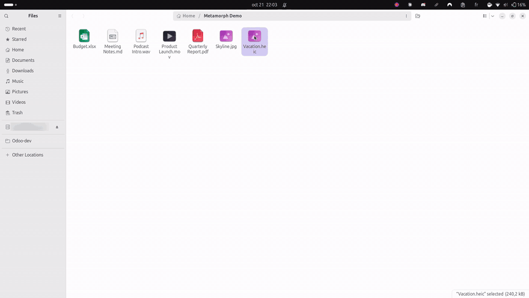
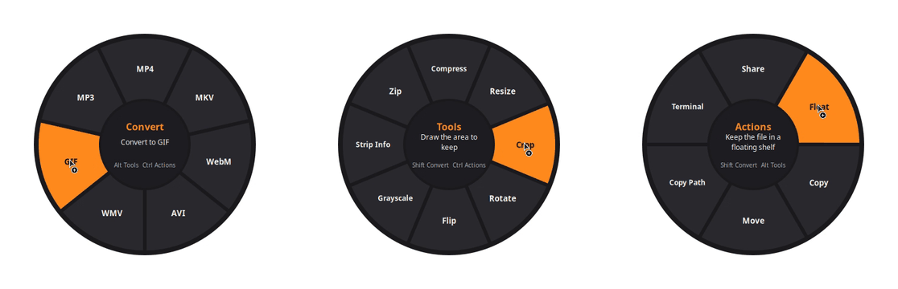
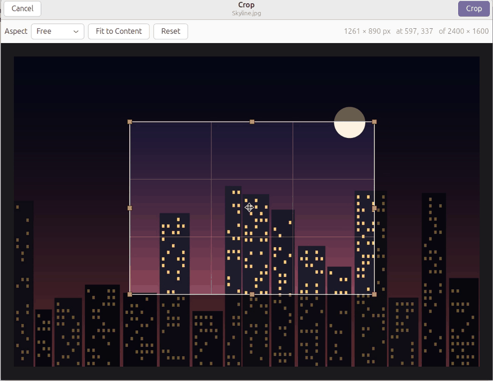

<p align="center">
  
</p>

<h1 align="center">Metamorph</h1>

<p align="center">
  <b>Convert any file without leaving your desktop.</b><br>
  Drag a file, hold a key, drop it on the format you want. Offline, free, open source.
</p>

<p align="center">
  <a href="LICENSE"></a>
  
  
  
</p>

<p align="center">
  
</p>

## Why Metamorph

Converting a file usually means finding the right app or uploading it to a
website. Metamorph puts every conversion one gesture away. Drag a file the way
you already do and hold a key: a wheel of formats opens under your cursor. Drop
the file on a slice and the result appears next to the original.

- **297 conversions** across images, audio, video, PDF, documents, ebooks,
  slides, spreadsheets, subtitles and archives
- **26 tools**, including compress, freeform crop, trim, split, merge, rotate
  and extracting pages
- **6 actions**: share, float, copy, move, copy path, open a terminal
- **Offline**: files never leave your machine
- **Works with any X11 app** that drags files (Files, browsers, Electron apps)

Inspired by [Tangerine for Mac](https://tangerineformac.com/). Metamorph is an
independent project, not affiliated with Tangerine.

## Three wheels, three keys

<p align="center">
  
</p>

| Hold while dragging | Wheel | What's on it |
|---|---|---|
| <kbd>Shift</kbd> | **Convert** | Every format the file can become (only formats that make sense for it) |
| <kbd>Alt</kbd> | **Tools** | Compress, crop, resize, rotate, trim, split, merge, PDF pages... |
| <kbd>Ctrl</kbd> | **Actions** | Share, Float, Copy, Move, Copy Path, Terminal |

The wheel stays open after you release the key. To pick a slice, drop the file
on it. To cancel, drop in the middle or press <kbd>Esc</kbd>. Pressing another
wheel key switches wheels mid-drag, and Settings lets you remap all three keys.

**Prefer the keyboard?** Select files in Files and press <kbd>F4</kbd>, or
right-click and choose **Scripts › Metamorph**. The arrow keys choose,
<kbd>Enter</kbd> applies, <kbd>Tab</kbd> switches wheels and <kbd>Esc</kbd>
closes it.

<p align="center">
  
  <br><sub>Crop opens an editor: draw the area, resize it from the handles, lock an aspect ratio, press Enter.</sub>
</p>

## Install

Requires Linux with an X11 session, Python 3.12+, and the GTK 3 and Xlib Python
bindings, all present on a stock Ubuntu 24.04 desktop
(`sudo apt install python3-gi gir1.2-gtk-3.0 gir1.2-rsvg-2.0 python3-xlib` elsewhere).

```sh
git clone https://github.com/thekolabs/metamorph.git
cd metamorph
./install.sh              # or: ./install.sh --no-autostart
nautilus -q               # once, so Files picks up the F4 shortcut
```

The installer needs no root and only writes to your home folder. It does the
following:

- creates `.venv` with the Python libraries, including standalone ffmpeg and
  pandoc binaries if the system has none
- links the `metamorph` command into `~/.local/bin`, and adds a menu entry and
  the Files script
- starts the background watcher, and by default starts it at every login

Metamorph never registers itself for file types, so it never becomes the app
that opens your files. `./uninstall.sh` removes everything the installer added.

### Optional packages

`metamorph doctor` (or **Settings › Capabilities**) shows which backends were
found. These system packages unlock more:

| Package | Adds |
|---|---|
| `libreoffice-impress` | All slide conversions (PPTX, PPT, ODP) |
| `libreoffice-writer` | `.doc` input, and Word to PDF with the original page layout |
| `libreoffice-calc` | XLS and ODS input, spreadsheets to ODS or PDF |
| `ghostscript` | Stronger PDF compression |
| `unrar` or `7zip` | RAR and 7z input |

## What it converts

The result is saved next to the original as `name.ext`, or as `name (2).ext` if
that name is taken. Inputs with several pages or sheets produce a folder. You
can choose a fixed output folder in Settings instead.

| Kind | Reads | Writes |
|---|---|---|
| Images | JPG PNG WebP HEIC TIFF AVIF BMP GIF SVG | JPG PNG WebP HEIC TIFF AVIF BMP PDF, GIF to MP4/WebM |
| Audio | MP3 M4A WAV FLAC OGG Opus AIFF WMA AAC | MP3 M4A WAV FLAC OGG Opus AIFF WMA |
| Video | MP4 MOV MKV WebM AVI WMV MPG 3GP FLV | MP4 MOV MKV WebM AVI WMV GIF MP3 |
| PDF | PDF | DOCX ODT PPTX XLSX JPG PNG EPUB TXT Markdown |
| Documents | DOCX DOC ODT Markdown TXT RTF HTML | DOCX ODT Markdown TXT EPUB HTML PDF |
| Ebooks | EPUB | PDF DOCX ODT Markdown TXT HTML |
| Slides | PPTX PPT ODP | PDF JPG PNG PPTX ODP |
| Spreadsheets | XLSX XLS ODS CSV TSV | XLSX ODS CSV TSV PDF |
| Subtitles | SRT VTT | SRT VTT TXT |
| Archives | ZIP TAR TAR.GZ GZ RAR 7Z | ZIP TAR TAR.GZ |

<details>
<summary><b>All 26 tools</b></summary>

| Files | Tools |
|---|---|
| Images | Compress, Resize, Crop (freeform editor), Rotate, Flip, Grayscale, Strip metadata |
| Video | Compress, Trim, Split, Mute, Extract audio, Rotate, Resize, Speed, Normalize loudness |
| Audio | Compress, Trim, Split, Speed, Normalize loudness |
| PDF | Compress, Split, Extract pages, Remove pages, Rotate, Extract images |
| Several files | Merge (images or PDFs into one PDF, videos, audio, text), Zip |
| Archives | Extract |

Tools that need options (trim times, page ranges, quality) ask for them in a
small dialog first.
</details>

<details>
<summary><b>How conversions behave</b></summary>

- Photos keep their EXIF orientation. Transparency is flattened onto white only
  for formats that can't store it.
- Video changes container without re-encoding when the codecs already fit
  (H.264/HEVC into MP4, MOV or MKV), so it's instant and lossless.
- PDF to images renders every page at 300 DPI. PDF to XLSX detects tables and
  reads numbers written either way (`1,234.5` or `1.234,5`).
- Documents go to PDF through LibreOffice when it's installed. Otherwise pandoc
  and PyMuPDF lay out the PDF, with no LaTeX needed.
- A mixed selection (say, a photo and a PDF) offers only the formats every file
  can become.
</details>

## Command line

Everything the wheel does is also available headless:

```sh
metamorph to webp photo.heic                                   # convert
metamorph run tool:media:trim talk.mp4 -p start=1:00 -p end=2:30
metamorph run tool:image:crop a.jpg -p rect=0.1,0,0.9,1        # x0,y0,x1,y1 as fractions
metamorph run tool:any:merge a.pdf b.pdf c.pdf
metamorph list report.pdf                                      # what applies to a file
metamorph doctor                                               # backends and counts
metamorph open photo.heic                                      # show the wheel for a file
```

## How it works

Every application that drags files on X11 does it through the XDND protocol,
and takes ownership of the `XdndSelection` when the drag starts. Metamorph's
watcher listens for that ownership change through XFixes. While the pointer
button is down it checks which modifiers are held, which works even while the
dragging app holds its grab. When a wheel key goes down, a wheel opens under
the cursor. The wheel is itself an XDND drop target: it reads the dragged file
list as soon as the pointer moves over it, offers the formats that apply, and
runs the slice the file is dropped on. Jobs run in the background, with a
progress popup in the corner of the screen.

```
metamorph/
├── watcher.py     X11 drag + modifier detection (XFixes, python-xlib)
├── wheel.py       the radial menu: XDND drop target and keyboard menu
├── registry.py    every conversion, tool and action, and what applies to a selection
├── engines/       images, media (ffmpeg), pdf, documents (pandoc), office, subtitles, archives
├── jobs.py        background queue, progress popup, notifications
├── actions.py     share, float shelf, clipboard, move, terminal
├── cropper.py     freeform crop editor
├── dialogs.py     settings window and tool options
└── app.py         single-instance GTK application tying it together
```

## Development

```sh
./install.sh --no-autostart          # sets up .venv
.venv/bin/python -m pytest tests -n auto
METAMORPH_DEBUG=1 bin/metamorph      # log what the drag watcher sees
```

The test suite generates a sample file in every input format. It runs every
conversion and decodes each output to check it (images open, media has
streams, PDFs have pages), then runs every tool. Conversions whose backend
isn't installed are skipped.

Contributions are welcome. Open an issue to discuss larger changes, and run
the tests before sending a pull request.

## Limitations

- The drag wheel needs an X11 session. On Wayland, use the drop zone in
  Settings, the Files script or the command line.
- A very quick tap of <kbd>Esc</kbd> during a drag can be missed. The dragging
  app still cancels the drag, and the wheel then closes.
- PDF to DOCX, XLSX and Markdown rebuild document structure heuristically, like
  any PDF converter. Scanned PDFs need OCR, which Metamorph doesn't do.

## License

Metamorph is released under the [MIT License](LICENSE).

Its dependencies are separate packages under their own licenses. Most are MIT
or BSD. Two exceptions matter if you redistribute Metamorph:

- **PyMuPDF** (PDF features) is AGPL-3.0, with a commercial license available
  from Artifex.
- **The standalone ffmpeg and pandoc binaries** fetched by `install.sh` are
  GPL builds.
